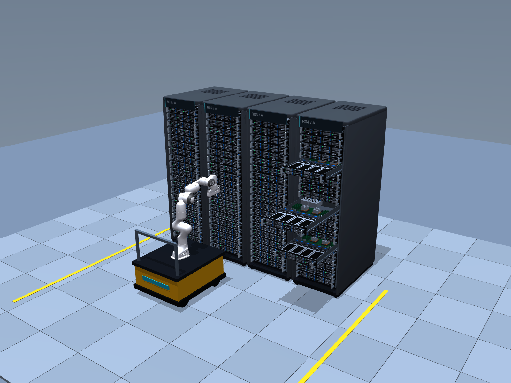

# Caddy: An autonomous data-centre service robot

**A robot for unmanned data centres that works out what's really broken, swaps it safely, and knows when not to touch anything.**



Small remote sites (edge, telecom, colocation) have no staff on site. A failed drive means someone has to travel out while the server runs without redundancy. Simple automation is risky: status LEDs lie, health reports glitch, and pulling a drive during a RAID rebuild loses the whole array.

This project has two layers:

- **Gemini (reasoning)** reads camera, thermal, SMART, LED and RAID state and decides **what** to do, including whether to do nothing and flag a human.
- **Arm layer (deterministic, no model)** decides **how**: rail and lift positioning from known rack geometry, collision-checked arm motion, and force limits read from joint torques. A jam stops the arm. It never pushes harder.

## How the agent reasons

The agent runs an observe → decide → act loop: it picks one action, the code carries it out in the simulator, the result is added to the incident log, and it decides again. It chooses when to gather more evidence, when to wait, when to act and when to stop.

- **Autopilot first.** Fixed rules in `policy.py` handle clear-cut swaps (bad SMART confirmed by the LED or heat). They hand over to Gemini only when signals disagree, a tray jams, a check fails or a condition doesn't clear after 4 waits.
- **Gemini reasons in a fixed format.** Every reply is JSON: observation, hypothesis, confidence (0–1), action, arguments. Each call is stateless: its memory is the incident log, rebuilt every turn (the last 30 entries plus the opening alert).
- **Rules in the prompt:** a drive counts as failed only when bad SMART is backed by the LED or heat; never pull during a RAID rebuild or while another drive in the group is down; wait out obstructions and rebuilds but not jams or dead drives; verify every insert before finishing.
- **Code has the final say.** Before a drive is pulled, `guard()` requires confidence of at least 0.8, a telemetry read for that bay, and live checks that still pass. It won't accept `done` while a drive is held or an insert is unverified. A refusal goes back to Gemini as the result.

**Inputs each call:** the rules, the incident log (the local monitor's alert, every earlier action with its confidence and result, and the autopilot's reason for handing over), the arm's state (position, what it holds, spares left, calls left), and the camera and thermal images on the turn after a `look`.

**Output:** one action: `look`, `read_telemetry`, `move_to`, `wait`, `pull_caddy`, `stow_old`, `pick_spare`, `insert_caddy`, `flag`, `safe_stop` or `done`.

**Limits:** 24 model calls and 900 s per incident. Invalid JSON gets one retry, then becomes `safe_stop`. If the budget runs out or Gemini can't be reached, `make_safe_and_stop` takes over without a model: it empties the gripper, stops the arm and flags every open bay for a human.

## Results

Every scripted incident in `robot/sandbox/scenarios.py` passes in the MuJoCo scene in **local-first** mode. A local autopilot handles routine steps and calls Gemini only when the evidence disagrees.

| Incident | What it tests | Gemini calls | Local steps |
| --- | --- | --- | --- |
| `clean_failure` | Red LED, hot, SMART FAIL | 0 | 7 |
| `misleading_led` | Amber LED on a healthy drive; the failing drive shows green | 3 | 8 |
| `raid_rebuild` | Failing drive in a group that is still rebuilding: **must wait** | 0 | 9 |
| `same_group_double` | Two bad drives in one group: order matters | 0 | 16 |
| `jammed_caddy` | Tray jams when pulled | 2 | 3 |
| `doa_spare` | First spare is dead on arrival | 6 | 7 |
| `false_alarm_heat` | Hot but healthy: cooling issue, not a drive | 3 | 1 |
| `smart_false_alarm` | SMART warns, nothing else agrees: don't pull | 4 | 1 |
| `smart_silent` | Failing but SMART says OK: flag for a human | 4 | 1 |
| `no_spares` | Nothing to swap in: flag it | 0 | 2 |
| `obstacle` | Approach blocked temporarily | 0 | 9 |
| `two_failures` | Two independent failures | 0 | 14 |

These counts were measured with `gemini-4-argon` in the `sim/` scene. That's 22 model calls across all 12 incidents. Gemini-only mode needed 89 calls for 9 of them.

## Where each model runs

| Component | Runs on | Model? |
| --- | --- | --- |
| MuJoCo physics, rendering | Local machine | No |
| Perception (LED, thermal, SMART parsing) | Local machine | No |
| Local autopilot (`policy.py`) | Local machine | No (fixed rules) |
| Arm layer (`robot/arm/`) | Local machine | No (deterministic) |
| Gemini reasoning (`gemini-3.5-flash-lite` for the demo on the `dcsim-robot` branch; `run_mujoco_argon.py` still defaults to `gemini-4-argon`) | Gemini API, called directly for the demo or through a Modal CPU function (holds the API key) | Yes, only on escalation |

## Install

You need [uv](https://docs.astral.sh/uv/). There are two environments: the project env (agent, Python 3.11+) and `.venv-mujoco` (simulator and arm, Python 3.11).

```sh
git clone https://github.com/J999UCL/agveraserobotics.git
cd agveraserobotics
uv sync
```

Simulator env on macOS/Linux:

```sh
./sim/setup.sh
```

Simulator env on Windows:

```sh
uv venv --python 3.11 .venv-mujoco
uv pip install --python .venv-mujoco/Scripts/python -r sim/requirements.txt
.venv-mujoco/Scripts/python sim/build_scene.py
```

Below, `.venv-mujoco/bin/python` is the macOS/Linux path. On Windows use `.venv-mujoco/Scripts/python`.

## Usage

**Check the scene** (about 30 s). It extends and closes all 80 trays:

```sh
.venv-mujoco/bin/python sim/run.py --check-trays
```
```text
PASS: 10s at home; 80 sliding servers, 99 bodies, 2149 geoms; no warnings
PASS: all 80 rails extended to 0.70m and returned to closed under bounded force ...
```

**Watch the arm open and close trays live:**

```sh
.venv-mujoco/bin/mjpython robot/arm/demo.py
```

**Explore the data centre by hand** (keys are listed in [sim/README.md](sim/README.md#viewer-controls)):

```sh
./sim/view.sh --showcase
```

**Run the agent on every incident in MuJoCo** (needs Modal, see [Configuration](#configuration)):

```sh
uv run --with trimesh==5.2.0 python robot/sandbox/run_mujoco_argon.py
uv run --with trimesh==5.2.0 python robot/sandbox/run_mujoco_argon.py --mode argon --only raid_rebuild
```

Traces go to `robot/sandbox/runs/mujoco/<mode>_<scenario>.json`, with frames in the matching folder.

**Run the tests** (no API key needed):

```sh
uv run --with trimesh==5.2.0 pytest robot/sandbox -q        # agent: 102 tests, ~30 s
.venv-mujoco/bin/python -m pytest robot/arm -q               # arm: ~5 min
```

## Configuration

| Setting | Where | Purpose |
| --- | --- | --- |
| `modal token new` | Shell, once | Log in to Modal. Gemini calls run there. |
| Modal secret `gemini` | Modal dashboard | Holds `GEMINI_API_KEY` for Gemini. |
| `--mode local_first` \| `argon` | `run_mujoco_argon.py` | Autopilot with escalation (default), or Gemini decides every step. |
| `--only a,b` | `run_mujoco_argon.py`, `modal_app.py` | Run selected incidents only. |
| `--trials N` | `modal_app.py` | Repeat each incident (toy-rack sandbox). |
| `trimesh==5.2.0` | `uv run --with` | Needed by the MuJoCo adapter. |

## Project layout

```text
sim/             MuJoCo data centre: 4 racks x 20 sliding 2U servers, Panda on rail + lift
robot/arm/       Deterministic arm layer: base.go_to, move_free/linear/guarded, open/close_tray
robot/sandbox/   Agent: scenarios, local autopilot, Gemini brain, MuJoCo adapter, Modal app
```

Simulator details, physics settings and arm internals are in [sim/README.md](sim/README.md). Asset provenance is in [sim/ASSETS.md](sim/ASSETS.md).

## Limitations

- Everything is simulated. Drives, RAM and fans move with their tray but cannot be removed individually yet.
- The arm skills (`open_tray`/`close_tray`) and the agent's actions are not wired together yet. The agent runs on the MuJoCo trays through `mujoco_adapter.py`.
- The MuJoCo runner needs a Modal login to start. If Gemini becomes unreachable mid-run, or its call budget runs out, the agent falls back locally: it empties the gripper, safe-stops and flags the open bays instead of guessing.

## Contributing

Work on a branch and open a pull request against `main`. Run both test suites first.

## License

No license has been chosen yet. Third-party asset licences are listed in [sim/ASSETS.md](sim/ASSETS.md).
