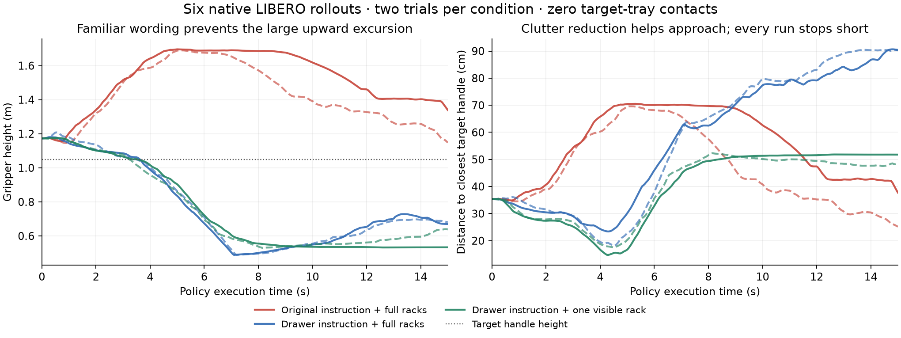

# Rack-policy investigation — 2026-11-08

The measured failure occurs before a grasp. The native controller follows inappropriate policy commands: with the maintenance instruction the arm rises away from the handle, then later descends. Familiar LIBERO wording removes the large upward excursion, and reducing visible clutter improves approach further. None of the tested conditions produces a grasp or extraction. Across ten short closed-loop trials there is zero observed target-tray contact and zero actual tray displacement.

The evidence supports instruction/scene grounding as a contributor. It does not isolate which word or visual feature is responsible, or prove that this checkpoint cannot learn the task. Prompt changes and simplified views are insufficient fixes.

## Closed-loop results

Two trials per condition, 300 policy actions each: 15 seconds of policy execution after ten settling steps. Every case uses the supplied LIBERO robot, OSC controller, gripper, cameras, observation preprocessing and `env.step` interface. Environment seed is 7. One unmodified OpenPI websocket server serves all cases sequentially; policy sampling noise is not paired in these rollouts.

| Condition | Closest target handle, trials 1 / 2 | Maximum gripper height, trials 1 / 2 | Gripper contact with target tray | Extraction |
|---|---:|---:|---:|---:|
| Four visible racks; original server instruction | 34.9 / 25.2 cm | 1.696 / 1.690 m | 0 / 0 frames | 0/2 |
| Four visible racks; familiar drawer instruction | 23.4 / 18.1 cm | 1.181 / 1.208 m | 0 / 0 frames | 0/2 |
| One visible rack; familiar drawer instruction | 14.7 / 17.5 cm | 1.175 / 1.174 m | 0 / 0 frames | 0/2 |

The target handle is at approximately 1.05 m. With familiar wording the hand crosses that height while still 20–26 cm short of the handle, then keeps descending to about 0.5 m. Removing the initial upward excursion does not fix the subsequent folding behavior. “One visible rack” hides the three distractor racks through visual alpha only. Every checked physical array matches across the six recorded models, including collision geometry, masses, friction, joints, damping and actuator parameters. The target rack still contains all twenty servers. The normal scene remains four visible racks.

The original instruction is `Pull out the server with the cyan handle.` The familiar instruction is `open the middle drawer of the cabinet`. This changes the whole instruction, so it cannot attribute the effect to the noun “server” alone. “Middle drawer” also gives a less precise handle-selection instruction than the cyan cue.

These short runs establish behavior over fifteen seconds, rather than a success rate for full episodes. Earlier three full-length native rack trials also failed.

## Closer-pose and wrist-visibility follow-up

A final four-trial test translates only target rack B by +0.18 m along Y, into the aisle. The full four racks and eighty trays remain visible. Comparison of compiled models finds exactly one changed physical array, `body_pos`, affecting only the target rack's root body; camera parameters, masses, geometry and actuator parameters match. The target starts about **19.6 cm** from the gripper instead of about 35.3 cm. Its wrist-camera visibility rises from zero to **488 pixels at 256×256**.

| Closer target, four visible racks | Closest target handle, trials 1 / 2 | Maximum gripper height, trials 1 / 2 | Observed target contacts | Extraction |
|---|---:|---:|---:|---:|
| Original server instruction | 18.6 / 16.4 cm | 1.484 / 1.324 m | 0 / 0 frames | 0/2 |
| Familiar drawer instruction | 15.7 / 14.5 cm | 1.173 / 1.174 m | 0 / 0 frames | 0/2 |

Because the starting distance also decreases, the smaller absolute gap cannot be credited wholly to improved policy behavior. This intervention changes distance, perspective and wrist visibility together; it cannot separate them. It nevertheless demonstrates that making the handle visible to the wrist camera and easier to reach is insufficient in these runs. The familiar-instruction cases again descend past the handle without reaching it.

## Matched-noise inference probes

240 requests: thirty input conditions across two recorded states, eight explicit Gaussian noise seeds per condition. These use OpenPI's public `Policy.infer(obs, noise=...)` API with the pinned `pi05_libero` checkpoint. The two states are at 0.5 and 5.5 seconds in a failed native episode. Every intervention receives identical noise for each seed.

The table evaluates the mean XYZ direction of the first five predicted actions at the initial state. “Toward” means its dot product with the vector to the target handle is positive; it does not imply correct orientation, contact or task success.

| Input condition | Predictions initially toward handle |
|---|---:|
| Original recorded images + server instruction | 0/8 |
| Original recorded images + familiar drawer instruction | 3/8 |
| Rerendered control + server instruction | 0/8 |
| Rerendered control + familiar drawer instruction | 5/8 |
| One visible rack + server instruction | 3/8 |
| One visible rack + familiar drawer instruction | 8/8 |
| Only the target tray visible within rack frames + familiar instruction | 8/8 |
| Table visuals restored + familiar instruction | 8/8 |
| Original images/instruction + zero numeric state | 0/8; actions exactly unchanged |

The rerendered controls account for small Mac/cloud rendering differences: initial external-camera mean absolute pixel error was about 1.05 on the 0–255 scale. Clutter and table comparisons use the corresponding rerendered control. Some changed conditions lose their favorable direction at the later, already-diverged state. The closed-loop results demonstrate why initial-direction probes alone cannot establish a fix.

Zeroing numeric state changes every predicted action by exactly zero at both tested states and all eight seeds. This agrees with the pinned π0.5 configuration: `discrete_state_input=False`, with no π0 continuous-state token. There is no extra LIBERO delta-state conversion in this checkpoint. Numeric-state sign changes cannot fix these outputs.

A positive visual control uses recorded inputs from the successful official drawer episode. Changing its familiar instruction to the server instruction substantially changes its initial action direction too. Thus the instruction is behaviorally consequential even on familiar images. Separate blank-camera probes also change outputs, sometimes closing the gripper prematurely; dropping a camera is not an established remedy.

## What the other experiments establish

- **Observation/API audit:** image rotation, resizing, state packing, five-action chunks and unchanged action delivery match the pinned official example. The known drawer episode starts the arm within about 1.3 cm of the rack starting pose. The supplied benchmark succeeded on 10/10 tasks before this investigation.
- **Recorder isolation:** the same 160 recorded commands through unwrapped and `DataCollectionWrapper` environments differ by at most **2.20e-8 m** at the gripper. The recorder does not materially cause the initial bad lift in this test.
- **Target visibility:** the external view contains about **75 handle pixels** at 224×224. The wrist view contains none initially; the target projects outside that camera's field of view. Both images are delivered to the policy. This is a limited, oblique view, but initial wrist visibility alone is not isolated as the cause; the successful benchmark also begins with only part of its cabinet in wrist view.
- **Approach failure:** the three earlier full native episodes get no closer than about 20.7, 34.8 and 20.9 cm to the cyan handle. The new six-run audit checks both handles and finds zero geometric contact between any robot part and the target tray in every saved control-step state.
- **Endpoint feasibility:** offline position-and-orientation optimization finds joint-limit-feasible static grasp poses with no detected robot/rack penetration above 0.1 mm, at closed, 0.3 m and 0.6 m extension. This is an offline geometry test, not a replacement controller or an executed extraction. Continuous-path and grasp-force feasibility remain untested.

Because the tested agent never contacts the target tray, rail friction, tray mass or extraction force cannot explain the observed pre-contact failure. Those mechanics may still need testing after a successful grasp.

## Corrected travel metric

The legacy `max_pull` field is the maximum absolute slider position. LIBERO's `Close` initialization samples a small nonzero offset. The earlier reported 0.132, 0.226 and 0.019 mm values equal those initial offsets, rather than actual tray travel. All three earlier episodes and all ten new short episodes show **zero increase from their initial extension**.

Logging now includes `initial_extension_m` and `max_extension_change_m` alongside the legacy absolute value. Success checking still uses LIBERO's native open predicate.

## Next discriminating test

Retain the full racks as context and place the exact successful LIBERO cabinet/handle in that environment with its known pose and initialization. Then substitute the server front/handle geometry separately. That would distinguish background/context sensitivity from recognition of the new target and transfer of its grasp affordance. The experiments here do not justify replacing the controller or claiming that prompt tuning has solved maintenance.

## Artifacts and reproduction

[Machine-readable results](diagnostics/rack-grounding-experiments.json) include the matched-noise summaries, all ten rollout outcomes, physical/contact audits, recorder comparison, and endpoint checks. Standard vendor episodes and policy inputs/outputs remain on Modal volume `agverase-mujoco-episodes` in workspace `j999ucl`:

- `investigations/20261108-041723`: matched-noise inference and recorder comparison.
- `investigations/20261108-042423-closed-loop`: six native episodes, source snapshots, policy records and summaries.
- `investigations/20261108-043913-pose`: four closer-pose native episodes and their policy records.
- `runs/20261108-015438-69171c/attempt-07`: successful official benchmark evidence.
- `runs/20261108-015438-69171c/attempt-08`: earlier three full native rack episodes.

Local downloaded diagnostics are in `.runtime/rack-investigation`. The downloaded short-run model XMLs use a local symlink to an already verified identical asset pool for analysis; the original portable vendor bundles on the volume retain their assets.

Read-only analysis scripts are `investigate_rack.py`, `investigate_grasp.py`, `summarize_rack_experiments.py`, and `audit_rack_rollouts.py`. Cloud experiment launchers enforce the existing reservation and refuse reusing their completed allowances. All experiment apps are stopped; the original $5 reservation was preserved, with unused runtime reconciled from verified completed-job timestamps. No training was performed.

Pinned sources: [OpenPI example](https://github.com/Physical-Intelligence/openpi/blob/215abfb217dbac7d5f1273282331b9b1866c0479/examples/libero/main.py), [public inference API](https://github.com/Physical-Intelligence/openpi/blob/215abfb217dbac7d5f1273282331b9b1866c0479/src/openpi/policies/policy.py), [checkpoint configuration](https://github.com/Physical-Intelligence/openpi/blob/215abfb217dbac7d5f1273282331b9b1866c0479/src/openpi/training/config.py), [LIBERO scene API](https://lifelong-robot-learning.github.io/LIBERO/html/procedural_generation/scene_creation.html).
